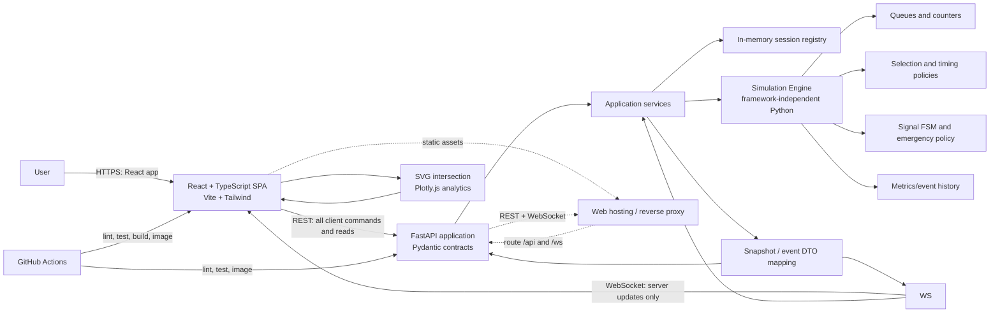
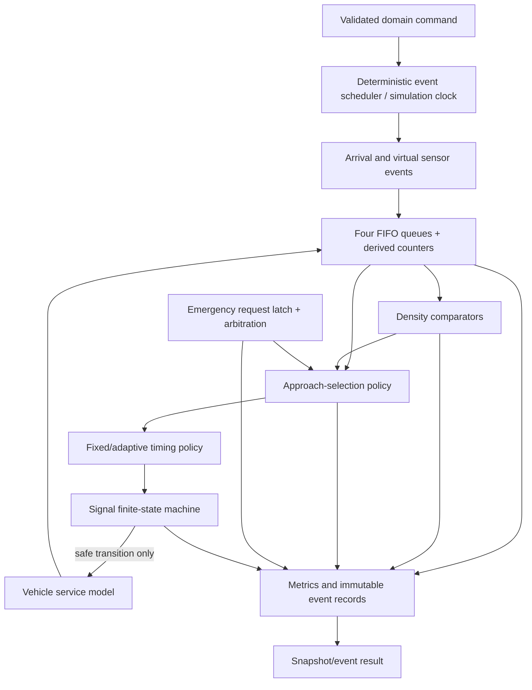

# Full-Stack Architecture Proposal

**Status:** For review; no implementation is included.

## 1. Scope and design goals

The deliverable is a browser-accessible full-stack website with a React/TypeScript frontend, Python/FastAPI backend, modular simulation engine, real-time updates, and analytics. The intersection, vehicles, arrivals, sensors, emergency requests, digital logic, and controller are virtual simulation entities. The application shall not connect to, control, or issue instructions to any real traffic equipment. Physical circuits, sensors, embedded controllers, ARM, FPGA, Arduino, and ESP32 are outside scope and are not proposed extensions.

The system performs **approach-level signal priority**: it selects which directional approach receives green. It does not reassign physical lanes. Physical hardware and real traffic control are excluded. The design keeps the frontend and backend independently buildable, keeps simulation rules independent of FastAPI, uses deterministic controllable simulation time, and sends backend-authored snapshots/events to browser clients. It avoids adding a database, message broker, cache, or separate microservices without a concrete need.

## 2. Overall architecture



The browser sends every client-initiated command through REST. FastAPI validates it and calls the shared application service, which locates the session and invokes the simulation engine. The service returns a REST response and publishes resulting updates to WebSocket subscribers. The engine advances its logical clock and applies deterministic events, queue changes, policy decisions, and FSM transitions. React updates the virtual intersection, Digital Logic Monitor, controls, and Plotly charts from versioned snapshots and ordered server events. WebSockets are server-to-client only in Version 1.

## 3. Technology responsibilities

| Technology | Responsibility | Notes |
|---|---|---|
| React | Component-based browser UI and client-side view state | Keep domain decisions on the backend. |
| TypeScript | Typed UI state, API contracts, and component props | Generated client types from OpenAPI may reduce drift; generation workflow TBD. |
| Vite | Frontend development server and production bundling | Serves the SPA in development; production hosting choice TBD. |
| Tailwind CSS | Styling and responsive layout | Avoid adding a separate component framework initially. |
| SVG | Intersection and vehicle visualization | Use SVG initially for accessible, inspectable objects; represent large queues compactly rather than rendering unbounded individual vehicles. |
| Python | Simulation engine and backend implementation | Supported version TBD. |
| FastAPI | REST routing, WebSocket lifecycle, dependency injection, OpenAPI | Transport/application boundary only; no simulation rules in route handlers. |
| Pydantic | Validate REST command payloads and serialize REST responses/WebSocket event schemas | WebSocket is outbound-only in Version 1; use explicit schema/versioning conventions. |
| WebSockets | Server-to-client versioned snapshots and ordered events | Client commands use REST only in Version 1. |
| Plotly.js | Interactive time-series and comparison charts in browser | Keep raw metric calculation in the backend; client may format/aggregate only for presentation. |
| Pytest | Unit and integration testing for Python engine and API | Engine unit tests should not start an HTTP server. |
| Vitest | Fast frontend component and client-state tests | Test protocol handling and rendering behavior. |
| Playwright | Browser end-to-end tests across user workflows | Browser matrix and CI execution strategy TBD. |
| Git/GitHub | Version control, review, repository hosting | Branch and review policy TBD. |
| Docker | Reproducible packaging for frontend serving and backend runtime | Whether frontend and API are separate images or a combined deployment is an operational decision; keep source/build boundaries independent. |
| GitHub Actions | CI for lint, type checks, tests, builds, and image validation | Deployment workflow/credentials are TBD; no automatic production deployment is assumed. |

No database or broker is needed for the first single-process, ephemeral simulation sessions. Persistence, multi-worker coordination, and cross-instance broadcast become required only if the product needs durable sessions or horizontal backend scaling.

## 4. Frontend component structure

Proposed React component tree (boundaries may be refined during UI design):

```text
App
├── AppShell
│   ├── Header / ConnectionStatus
│   └── WorkspaceLayout
│       ├── SimulationToolbar
│       │   ├── ModeSelector (fixed-time / adaptive)
│       │   ├── RunControls (run / pause / step / reset)
│       │   └── SpeedAndScenarioControls
│       ├── IntersectionPanel
│       │   ├── IntersectionSvg
│       │   ├── ApproachPanel × 4
│       │   │   ├── QueueCounter
│       │   │   ├── DensityBadge
│       │   │   └── VehicleQueueView
│       │   └── SignalStateIndicator
│       ├── EmergencyRequestPanel
│       ├── DigitalLogicMonitor
│       │   ├── CounterRegisterView
│       │   ├── DensityComparatorView
│       │   ├── PriorityEncoderView
│       │   ├── TieBreakPointerView
│       │   ├── EmergencyLatchView
│       │   ├── FSMStateAndTransitionView
│       │   └── AdaptiveTimerView
│       ├── AnalyticsPanel
│       │   ├── MetricCards
│       │   └── PlotlyCharts
│       └── EventLog / RunSummary
```

Suggested frontend modules:

- `features/simulation`: controls, session state, and simulation view models.
- `features/intersection`: SVG rendering from a typed snapshot.
- `features/digital-logic`: readable visualization of simulated digital signals and decisions.
- `features/analytics`: Plotly charts built from metric/history payloads.
- `services/api`: REST client and error mapping.
- `services/realtime`: WebSocket connection, reconnection, heartbeat, message validation, and sequence-gap handling.
- `types/contracts`: generated or shared transport types; never duplicate business rules here.

Client state is a projection of authoritative server snapshots plus transient UI state (selected tab, open panel, etc.). The REST response acknowledges each command; subsequent WebSocket events/snapshots update the authoritative view. The client does not optimistically mutate controller state.

## 5. Backend API architecture

Use a layered modular monolith initially:

1. **Transport layer** (`api/rest`, `api/websocket`): REST parses and validates all client input; WebSockets send server updates only.
2. **Application layer** (`services`): session lifecycle, authorization boundary if introduced, shared REST command orchestration, publication, and error translation.
3. **Domain/simulation layer** (`simulation`): pure Python entities, policies, deterministic clock, event scheduler, FSM, and metrics; must not import FastAPI or Pydantic.
4. **Infrastructure layer** (`sessions`, `realtime`, `config`): in-memory session registry and connection management for initial deployment.

Routes should be thin. Pydantic request/response models are transport contracts; the engine uses internal dataclasses/domain types and receives explicit conversion at the boundary. The engine should expose a small deterministic interface such as create state, apply command, advance by a defined amount/event count, and return snapshot/events. Exact method signatures are TBD.

### Session and concurrency model

Each simulation session owns isolated engine state and one command stream. REST commands for a session must be serialized so that simultaneous clients cannot advance the same clock concurrently or reorder state-changing commands. In a single process this can use per-session coordination around synchronous engine operations; do not make the deterministic engine itself depend on asyncio. Execution off the event loop may be needed for expensive runs, to be decided after performance targets are known.

Initial session storage may be in-memory and process-local. It loses sessions on restart and does not support multiple API workers consistently. Production session persistence, ownership/authentication, session expiry, quotas, and multi-instance coordination are TBD. Until decided, deployment should use one API worker for stateful sessions.

## 6. Proposed REST API

Prefix `/api/v1`. JSON schemas use Pydantic. Identifiers are opaque UUIDs. Exact fields and pagination are TBD; this is a resource/action proposal, not a finalized contract.

| Method and path | Purpose |
|---|---|
| `POST /api/v1/simulations` | Create a session from mode, configuration, and optional scenario; return `simulation_id`, initial snapshot, and WebSocket URL/token if auth design requires it. |
| `GET /api/v1/simulations/{id}` | Return current simulation snapshot and lifecycle status. |
| `PATCH /api/v1/simulations/{id}/configuration` | Update allowed configuration while paused (mutability rules TBD). |
| `POST /api/v1/simulations/{id}/run` | Set lifecycle to RUNNING and start repeated 1,000 ms engine advances. An already-running session remains running. |
| `POST /api/v1/simulations/{id}/pause` | Set lifecycle to PAUSED and stop future advances; the current serialized 1,000 ms quantum completes first. |
| `POST /api/v1/simulations/{id}/step` | When PAUSED, advance exactly 1,000 simulated milliseconds once. Reject when RUNNING. |
| `POST /api/v1/simulations/{id}/reset` | Reset to initial state while preserving or replacing configuration (TBD). |
| `POST /api/v1/simulations/{id}/arrivals` | Inject one or more virtual vehicle arrivals for controlled scenarios. |
| `POST /api/v1/simulations/{id}/emergency-requests` | Latch a virtual emergency request for an approach. |
| `GET /api/v1/simulations/{id}/metrics` | Return current or completed-run metrics and optional time series. |
| `GET /api/v1/simulations/{id}/events` | Retrieve bounded event history if retained; pagination/retention TBD. |
| `DELETE /api/v1/simulations/{id}` | End and release an ephemeral simulation session. |

No REST request accepts an advance duration above 1,000 simulated milliseconds. Step advances exactly 1,000 ms; Run is a lifecycle command and its server runner invokes one bounded 1,000 ms engine quantum per iteration. Commands should include an idempotency key or command ID for retries where duplicate arrivals, emergency requests, or stepping would otherwise produce duplicate effects. `expected_state_version` or equivalent optimistic concurrency check is recommended for state-changing REST commands. Error envelope, conflict semantics, rate limits, auth, CORS, and exact validation constraints are TBD. Avoid an endpoint for directly setting a signal to GREEN; the controller FSM owns transitions.

## 7. WebSocket communication design

Suggested endpoint: `GET /ws/v1/simulations/{simulation_id}` (WebSocket upgrade). Query-string credentials should be avoided; authentication approach is TBD. In Version 1, the connection is server-to-client only: REST is the sole channel for client commands.

### Server-to-client message types

- `simulation.snapshot`: authoritative complete initial/current state, with schema version and monotonically increasing `state_version`.
- `simulation.event`: discrete ordered event such as arrival, vehicle served, density changed, approach selected, emergency latched/served/cleared, FSM transition, or mode change.
- `simulation.metrics`: current aggregated metrics or a versioned metric window.
- `simulation.status`: running/paused/completed/error and simulation clock.
- `protocol.error`: subscription/authorization/limit failure or unsupported protocol version.

REST responses acknowledge client commands. WebSocket messages contain server-produced state/events only; clients do not send application data frames on the socket. WebSocket protocol ping/pong control frames may be used for connection health.

### Ordering, recovery, and flow control

- Every snapshot carries `protocol_version`, `simulation_id`, `state_version`, `last_event_sequence`, and `simulation_time`. Every event carries `protocol_version`, `simulation_id`, `event_sequence`, `state_version`, and `simulation_time`.
- The application service serializes REST commands per session and publishes resulting ordered engine events and updated snapshots.
- On every connect or reconnect, the server registers the subscriber and captures the complete current snapshot under the session's command ordering lock. It sends that snapshot with the latest `last_event_sequence`, then sends later generated events in order. Version 1 does not require replay of historical events missed while disconnected.
- The client accepts only the next expected event sequence and increasing state versions. On a gap, invalid order, or incompatible version, it discards incremental state, closes the connection, and reconnects; the server sends a fresh complete snapshot before resuming live events.
- Reconnect with bounded exponential backoff and jitter in the browser. Reconnection restores the view; it does not silently start, pause, or advance the simulation.
- Apply bounded outbound queues and coalesce replaceable snapshots/metrics under slow-client pressure; preserve ordered controller transition events. Backpressure policy and hard limits TBD.
- Do not broadcast at a fixed high frame rate by default. Publish on meaningful state changes and/or a configurable UI cadence; target rate TBD.
- Define ping interval, timeout, payload size, maximum clients per session, and idle-session expiry before deployment (TBD).

All REST commands and WebSocket publication must use the same application service and simulation engine. WebSockets do not accept simulation commands in Version 1.

## 8. Traffic simulation engine architecture

Keep the engine deterministic, framework-independent, and free of wall-clock sleeps. It owns logical time, arrivals, queues, selection, timing, emergency state, signal FSM, service, and event/metric generation.



Suggested engine modules:

- `domain/models`: direction, vehicle with arrival timestamp, request, signal state, configuration, simulation state.
- `engine/clock`: integer logical time in milliseconds and deterministic event scheduler.
- `engine/queues`: four FIFO queues; counters are derived as `len(queue)`.
- `logic/density`: provisional 0–4 LOW, 5–9 MEDIUM, 10+ HIGH comparator.
- `logic/selection`: max-queue choice and rotating tie-break. This answers *which approach* is requested.
- `logic/timing`: fixed/adaptive duration policy. Adaptive green is `clamp(5, 30, 5 + Q)` seconds, where `Q` is the ordinary vehicle queue length captured when the phase is selected. Fixed mode uses N → E → S → W with 10-second green phases.
- `logic/emergency`: separate emergency-entity FIFO, request arbitration, service/clear, and recovery intent.
- `controller/fsm`: GREEN/YELLOW/ALL-RED transitions and service eligibility (service occurs only during GREEN). This answers *when a change is legal*.
- `engine/service`: FIFO discharge using the configured headway.
- `analytics/metrics`: derived measures from event/state history.
- `engine/events`: ordered domain events and snapshot production.

The selector must not directly mutate FSM state. It produces a desired next approach. The FSM owns transition sequencing and, when changing approaches, requires GREEN → YELLOW → ALL-RED → GREEN. Adaptive green is `G = clamp(5, 30, 5 + Q)` seconds, with `Q` sampled from the selected approach's ordinary FIFO queue at phase selection. The 5-second minimum/base and 30-second maximum are provisional simulation values requiring academic validation. Fixed mode uses the repeating North → East → South → West order with a provisional 10-second green duration per approach; empty scheduled approaches retain their full duration and serve zero vehicles. Yellow = 3 seconds, All-Red = 1 second, and vehicle-service headway = 2 seconds remain provisional values requiring validation. There is no-demand startup in ALL-RED, and same-approach green renewal behavior is defined below.

### Startup, demand, and consecutive same-approach service

The initial state is ALL-RED with no active approach or phase deadline. With no ordinary vehicles and no pending emergency entities, the controller remains ALL-RED indefinitely. An arrival at the initial ALL-RED state is considered by the controller at that timestamp; because the junction is already in ALL-RED, the first selected GREEN may begin without waiting an additional all-red interval.

Adaptive mode selects the maximum ordinary queue, unless an emergency request has priority. If no ordinary or emergency demand exists at a phase-selection point, remain ALL-RED. Fixed mode remains ALL-RED until demand arrives. If an emergency request is pending, the oldest request receives the next safe GREEN; otherwise ordinary demand starts/rejoins the fixed sequence at the stored next direction, initially North. Empty approaches in an active fixed cycle still receive their complete 10-second greens while demand remains elsewhere. If all ordinary and emergency demand has cleared by a phase-selection point, finish the current green and safe transition through YELLOW and ALL-RED, then idle ALL-RED rather than running empty cycles.

If the same approach is selected again at a green phase boundary, keep the signal continuously GREEN for that approach and renew its phase timer; do not insert YELLOW/ALL-RED or create a direct GREEN-to-GREEN state transition. The old phase's service deadline is still exclusive at the boundary: no vehicle is served at the ending timestamp. A new service opportunity is scheduled one full service headway after renewal. Any change to a different approach always follows GREEN → YELLOW → ALL-RED → GREEN. For every GREEN phase, the first service opportunity occurs one full 2-second headway after green begins; later opportunities are spaced by 2 seconds.

### Deterministic control

**Version 1 clock:** simulation time is an integer count of milliseconds. The engine is event-driven and processes all scheduled events at their logical timestamps up to the end of an advance; it does not use wall-clock time or `sleep()` to determine simulation outcomes. A single engine advance is capped at 1,000 simulated milliseconds. The user-facing Step command advances exactly 1,000 ms. Run sets lifecycle to `RUNNING` and repeatedly invokes the same `advance(1000)` operation. Pause sets lifecycle to `PAUSED`; commands and advances are serialized per session, so a current quantum completes and no subsequent quantum starts after Pause takes effect. Step is accepted only while paused. Reset creates the initial state and returns to paused. Repeated Run while running and repeated Pause while paused are idempotent. Run pacing is a backend scheduling concern and is not controlled by browser playback speed.

Playback speed is a frontend presentation setting that controls interpolation/replay cadence between server-authoritative updates. It never controls engine advancement, quantum size, event order, logical timestamps, or controller decisions. Its allowed range and default are TBD. Browser animation never drives simulation logic. The command log records each accepted command in sequence with the logical timestamp/state version at which it applies; replay uses this ordered log, including Run/Pause boundaries, together with initial configuration, scenario, and random seed (if stochastic arrivals are later approved), to reproduce identical domain events and final state. Events at a shared timestamp are handled in the fixed order below; ties within each listed category use stable insertion order, and external arrivals/requests preserve command-sequence order:

1. Process signal phase deadlines. If a GREEN phase allocation ends at timestamp `T`, expire that phase's service eligibility before service processing; its scheduled service event cannot serve at `T`. At controller resolution, the GREEN indication may continue without a state change if the same approach is selected again, otherwise it enters YELLOW.
2. Process eligible vehicle-service events only if their approach remains GREEN after deadline processing.
3. Apply external vehicle arrivals and emergency requests at `T` in stable command-sequence order.
4. Resolve controller decisions, considering requests and arrivals at `T`, including emergency priority and normal approach selection.
5. Schedule subsequent service and phase events.
6. Publish the ordered domain events and updated state.

At the end of ALL-RED, apply this same ordering: phase deadline first, then eligible service (none during ALL-RED), then arrivals and emergency requests at that timestamp, then selection of the next GREEN approach. This ensures all requests and arrivals registered at that timestamp participate in selection. Domain events receive monotonically increasing per-session sequence numbers in the order produced by these processing steps.

## 9. Digital electronics logic in software

Digital electronics concepts are represented as explicit software state and combinational decisions and displayed in the Digital Logic Monitor. No circuit, gate-level electrical behavior, sensor hardware, or external I/O is implied.

| Concept | Software representation | Monitor presentation |
|---|---|---|
| Digital vehicle counter | Queue length derived from FIFO queue state | Four current count values, optionally binary display (format TBD) |
| Density comparator | Threshold comparison over each queue count | Thresholds and active LOW/MEDIUM/HIGH output |
| Priority encoder | Highest queue length converted to one or more candidate approaches | Queue inputs, max value, winning/candidate direction(s) |
| Rotating arbiter | Persisted selector pointer chooses among equal maximum candidates | Pointer position, tie set, selected direction |
| Emergency latch | Pending request state retained until policy clears it | Active request, source approach, latched/served/cleared state |
| Adaptive timer | Deterministic duration calculation, clamped to configured bounds | Inputs, computed duration, clamp status, remaining time |
| FSM/registers | Current signal state, active approach, transition deadline, next target | Current state, legal next state, elapsed/remaining phase time, transition history |
| Virtual sensor | Scenario event that reports an arrival/request into the model | Event source and event timestamp |

The monitor should expose inputs, outputs, and reason codes so that a viewer can trace why an approach was selected. It visualizes computed software state; it should not claim to reproduce physical voltage levels, hardware timing, or synthesized logic. Binary width/encoding and naming convention are TBD.

## 10. Emergency vehicle handling

An emergency vehicle is a separate virtual entity with its own request ID, approach, request timestamp, and FIFO position; it is never inserted into or reordered within the ordinary vehicle queue. Pending emergency entities are ordered by request timestamp, then by stable external command sequence for simultaneous requests. Emergency vehicles and ordinary vehicles share the approach's service opportunities: at a service event, the globally oldest pending emergency entity is served first if its approach is active GREEN; otherwise an ordinary FIFO vehicle may be served. At most one entity is served per headway event, and serving an emergency entity does not remove or reorder an ordinary vehicle.

An emergency request never interrupts the current GREEN. If the oldest pending emergency request belongs to the currently green approach, it is served at the next eligible service event within the existing phase; the phase timer is neither restarted nor shortened. If its service opportunity falls at or after the green deadline, the deadline wins and the request remains pending. At the phase decision, if that same approach is selected again, GREEN is continuously renewed and the request waits for the next service opportunity; if a different approach is selected, the request waits through YELLOW and ALL-RED before its approach can receive GREEN. If the oldest request belongs to another approach, the current green completes normally, followed by YELLOW and ALL-RED, before that approach can receive GREEN.

Emergency service completion is the service event at which that emergency entity is served. The entity is removed from the emergency request FIFO and its request latch is cleared at that timestamp; request response time is service timestamp minus request timestamp. The phase continues for its already-selected duration. At phase end the controller proceeds through the normal safe transition. If emergency requests remain, the oldest pending request is selected at the next safe phase-selection point; otherwise the controller returns to ordinary mode policy (adaptive max-queue or the stored next fixed-order direction). In fixed mode, after an emergency-priority phase the stored next direction is the direction after the emergency-served approach. For a priority-selected phase, green duration follows the active operating mode: adaptive formula using the ordinary queue length sampled at selection, or the fixed 10-second duration. These emergency sequencing/service conventions and their timing values are provisional simulation rules requiring academic validation; they are not real-world preemption guidance.

## 11. Performance analytics architecture

The engine emits ordered domain events and a run history sufficient to derive metrics. The backend analytics module calculates authoritative metrics; REST can return summaries/history and WebSocket can stream current values or bounded time-series samples. Plotly.js renders them in the browser. Avoid recalculating domain metrics separately in React.

For every served ordinary vehicle, waiting time in milliseconds is its service-event timestamp minus its arrival timestamp; display seconds by dividing by 1,000. Per-approach and overall average waiting time are the sum of completed ordinary vehicle waits divided by the count of completed ordinary vehicles in that scope; if none were served, report no value. Emergency response time is service-event timestamp minus request timestamp, reported separately in seconds. Each service event completes instantaneously in simulation time; the 2-second headway is the spacing between service opportunities, not an added service duration.

Throughput over a reporting interval `[t0, t1)` is the count of service events with timestamps `t0 ≤ t < t1`; report ordinary and emergency completions separately and combined, and normalize to vehicles per simulated minute as `count × 60,000 / (t1 - t0)` when `t1 > t0`. A service event exactly at `t1` belongs to the next interval. Queue wait for vehicles not yet served may be shown as elapsed wait at snapshot time, but it is excluded from completed-vehicle average waiting time. Maximum wait is the maximum among completed ordinary vehicles; no percentile is required in Version 1. These service and metric conventions and the provisional 2-second headway should be academically validated before results are interpreted as traffic research findings.

The backend analytics module calculates these metrics from ordered service events and event history; Plotly.js renders them in the browser. Retention, chart-window defaults, and export format remain TBD.

## 12. Testing strategy

### Python / Pytest

- Pure unit tests for FIFO/timestamps/counter invariants, density boundaries, maximum selection, tie rotation, timing clamps, emergency latching, and FSM transitions.
- Property/invariant tests for monotonic logical time, queue count equals length, no duplicate service, deterministic replay, and no direct GREEN-to-GREEN transition.
- Engine integration tests using fixed scripted events and exact expected transition/event sequences.
- Same-timestamp ordering tests proving phase deadlines precede service (no service at a green deadline), service precedes external events, external arrivals/requests retain command order, controller selection follows those events, and publication preserves sequence order.
- ALL-RED deadline tests proving arrivals and emergency requests at the clearance timestamp are considered before the next GREEN approach is selected.
- Deterministic replay tests that run identical initial configuration and REST command sequences twice and compare the complete event stream and final state.
- Run/Pause/Step lifecycle tests proving Step advances exactly 1,000 ms, each engine quantum is capped at 1,000 ms, Pause prevents subsequent quanta, presentation playback speed does not alter logical outcomes, and browser animation cannot advance engine time.
- FastAPI tests for schemas, validation errors, lifecycle endpoints, idempotency/conflict behavior, and session isolation.
- WebSocket tests for initial snapshot, ordering/versioning, reconnect snapshot, rejection of client command frames, and slow-client/backpressure behavior.

### Frontend / Vitest

- Component tests for queue counters, density indicators, traffic visualization, Digital Logic Monitor, controls, analytics empty/loading/error states, and accessibility labels.
- Service tests for REST validation/error mapping and WebSocket sequencing, reconnect, stale versions, and snapshot resynchronization.

### End-to-end / Playwright

- Create a simulation, inject deterministic arrivals, observe queue/counter updates, run/pause/step, and reset.
- Validate adaptive selection and fixed/adaptive mode views against controlled scenarios.
- Trigger an emergency request and verify the visible transition path goes through YELLOW and ALL-RED before the emergency approach GREEN.
- Validate analytics update and responsive browser layout.

CI should run format/lint/type checks, Pytest, Vitest, frontend production build, and selected Playwright workflows. Exact tools beyond named test frameworks, browser matrix, coverage target, and test shard strategy are TBD. Tests should avoid random timing and use deterministic fixtures.

## 13. Deployment strategy

Proposed initial deployment is a single-origin browser app with static frontend assets and a FastAPI service behind a reverse proxy/load balancer. The proxy serves the SPA and routes `/api/v1/*` and `/ws/*` to FastAPI, with WebSocket upgrade support and TLS at the edge. Docker packages reproducible frontend build/static hosting and API runtime; separate frontend and backend images preserve independent builds/deploys while keeping operations simple. A reverse proxy may be provided by the deployment platform rather than introducing another container.

GitHub Actions should validate pull requests (format/lint, type checks, unit/integration tests, frontend build, Docker build). Production hosting provider, registry, environments/secrets, deployment approval, monitoring, backups, and rollback policy are TBD. Do not deploy automatically to production without a later explicit deployment design.

The first stateful deployment should use a single API worker with in-memory simulation sessions. Multiple workers/replicas would split session state and WebSocket publication; scale-out requires a shared session/event architecture (and likely persistence/pub-sub) or deterministic session ownership. Do not add Redis or a database until session durability or multi-instance requirements justify them. Define limits for concurrent sessions, run duration, event history, and message rates before public exposure (TBD).

## 14. Proposed repository structure

The controller performs approach-level signal priority: it selects which of the North, South, East, or West approaches receives green. It does not reassign physical lanes.

```text
project-root/
├── frontend/
│   ├── src/
│   │   ├── app/
│   │   ├── components/
│   │   ├── features/{simulation,intersection,digital-logic,analytics}/
│   │   ├── services/{api,realtime}/
│   │   ├── types/
│   │   └── styles/
│   ├── public/
│   ├── package.json
│   ├── vite.config.ts
│   ├── tailwind.config.*
│   ├── tsconfig.json
│   └── Dockerfile
├── backend/
│   ├── src/traffic_app/
│   │   ├── main.py
│   │   ├── api/{rest,websocket}/
│   │   ├── schemas/
│   │   ├── services/
│   │   ├── sessions/
│   │   ├── realtime/
│   │   └── simulation/{domain,engine,logic,controller,analytics}/
│   ├── tests/{unit,integration}/
│   ├── pyproject.toml
│   └── Dockerfile
├── e2e/
├── docs/
├── .github/workflows/ci.yml
├── docker-compose.yml
├── PROJECT_SPECIFICATION.md
├── ARCHITECTURE_PROPOSAL.md
├── README.md
└── LICENSE
```

This structure is a proposal only. It does not create directories, dependencies, or application code.

## 15. Technology choices to review

- **SVG:** SVG is the Version 1 intersection visualization choice. Compact queue symbols should prevent large queues from creating an excessive number of rendered nodes.
- **REST plus WebSockets:** REST is the only client-to-server command channel; WebSockets publish server-to-client snapshots/events. Both REST execution and publication converge through the same application service and engine.
- **In-memory sessions:** Simplest and appropriate for an initial single-process simulation, but sessions vanish on restart and do not scale across workers. Confirm whether persistence/multi-user sharing is required before selecting infrastructure.
- **Run lifecycle:** Run repeats deterministic 1,000 ms advances; Pause takes effect at a serialized quantum boundary. Playback speed affects only frontend interpolation/replay, not logical simulation outcomes.
- **Plotly.js payloads:** Full history can grow without bound. Prefer bounded windows or downsampled series for live updates and retain event records for accurate summaries.
- **Docker/CI scope:** Docker and GitHub Actions fit reproducible builds and quality checks. A specific cloud host, database, broker, authentication provider, or observability stack is not justified yet.
- **Pydantic/API type sharing:** OpenAPI-based TypeScript generation can reduce schema drift but adds a generation/check step. Choose whether generated client contracts are committed or generated in CI.
- **WebSocket security:** Authentication, origin restrictions, per-session authorization, and connection limits need design before any internet-facing deployment.

## 16. Unresolved architectural decisions

1. **Scenario and queue inputs:** manual/scripted versus stochastic arrivals, distributions, default scenarios, run horizon, queue capacity/overflow, extra vehicle fields, and duplicate-input idempotency.
2. **Selection details:** density's role beyond display, threshold configurability, and tie-break pointer advancement/reset behavior.
3. **Academic validation:** calibration/validation method and acceptance criteria for the provisional thresholds, timing values, service headway, and emergency policy.
4. **Metric extensions:** queue and signal-time aggregation windows, chart windows, and export needs. Completed-vehicle waiting, emergency response, and throughput formulas are defined in Section 11.
5. **Playback/interface:** allowed playback-rate range/default, editable settings, rendering limits, and accessibility requirements. SVG is the Version 1 renderer; browser animation does not control simulation logic.
6. **REST/WebSocket contract:** final request/response fields, error envelope, idempotency/conflict policy, schema-version handling, ping/pong timing, backpressure, event retention, and request/connection rate limits. Client simulation commands remain REST-only.
7. **Sessions/security:** authentication, ownership/sharing, expiry, restart behavior, persistence, concurrent-session quotas, and multi-worker scaling.
8. **Engineering/deployment:** supported Python/Node versions, dependency policy, exact engine method signatures, test coverage/browser matrix, performance/resource limits, hosting/image layout, secrets/TLS, monitoring, rollback, and CI deployment policy.

The initial ALL-RED state and no-demand behavior, `G = clamp(5, 30, 5 + Q)` adaptive formula, North → East → South → West fixed cycle with 10-second phases, empty fixed-phase behavior, emergency FIFO/service/clear/recovery rules, same-approach GREEN renewal, integer-millisecond event order, 1,000 ms Step/Run quantum and cap, Run/Pause lifecycle, deterministic replay, and exact Version 1 waiting/throughput formulas are defined above. Those numerical/control defaults remain provisional pending academic validation where stated.

## 17. Scope boundary

This is strictly virtual traffic simulation software delivered as a browser-accessible website. All sensors, counts, requests, traffic movement, and digital electronics concepts are modeled in software. No physical traffic equipment, circuits, sensors, embedded boards, microcontrollers, FPGA, or real-world traffic control is part of this project or a proposed extension.
